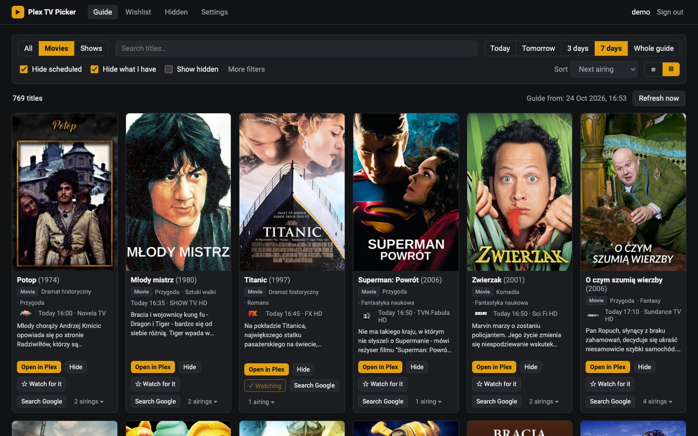
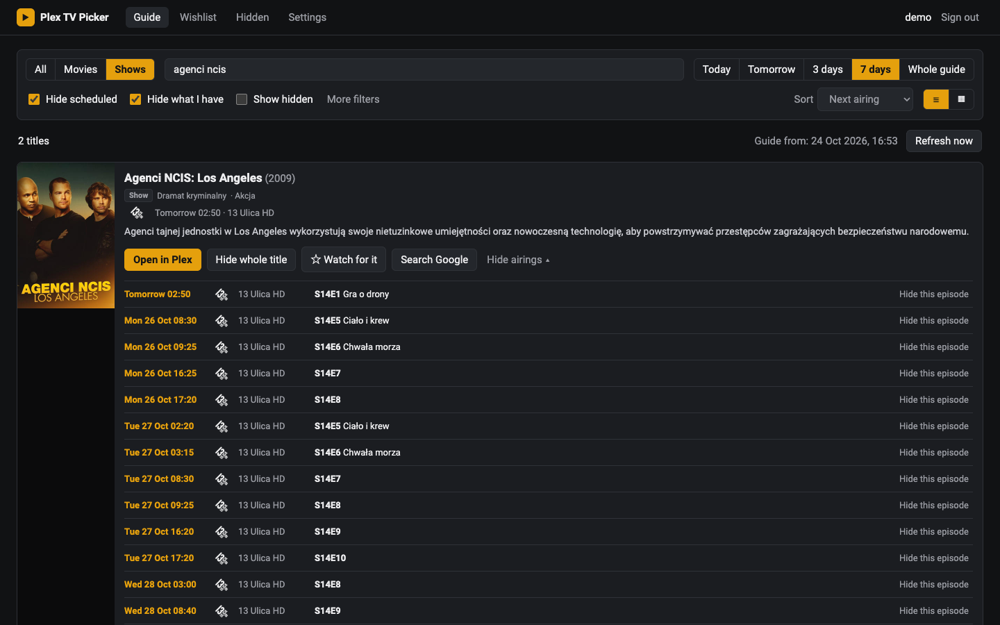
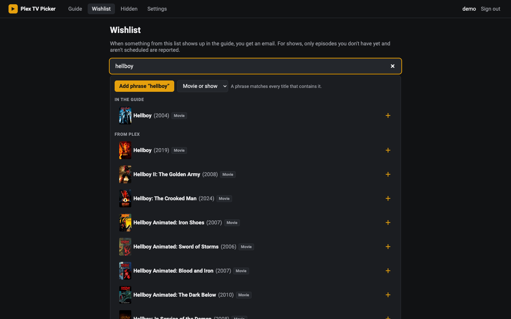
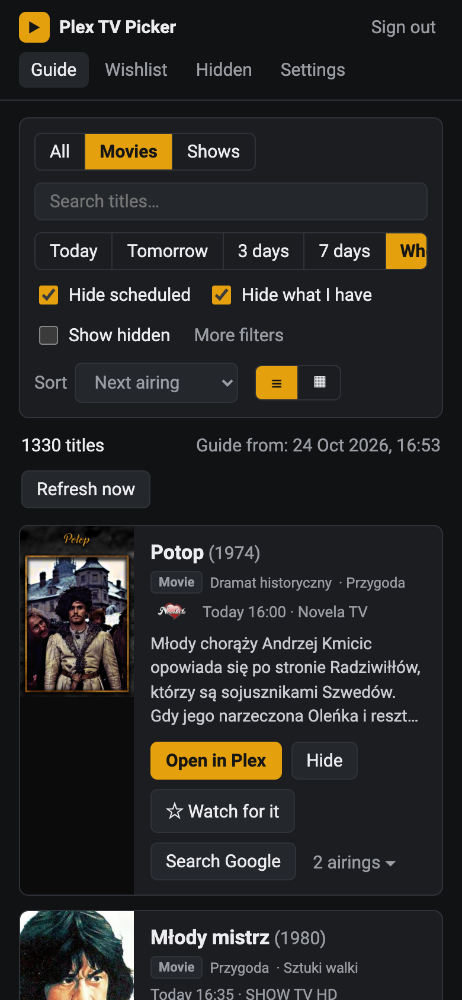

# Plex TV Picker

[](https://github.com/kepak1/plex-tv-picker/actions/workflows/ci.yml)
[](LICENSE)
[](https://ko-fi.com/kepak1)

A self-hosted companion page for **Plex Live TV & DVR** that makes picking what to record much easier.

Plex's *Live TV → Browse* shows the same titles you already skipped over and over, gives you little room to filter, and hides the description behind a click. Plex TV Picker shows the whole guide as a poster list with the description visible, lets you hide what you are not interested in, and emails you when something from your wishlist shows up in the guide. One click takes you to the item in Plex, where you press **Record**.



## Features

- **The whole guide in one list**: movies and shows with posters, full descriptions, genres and every airing (channel, time, season/episode). List or grid view, works on phones.
- **Filters**: movies/shows, title search, genre, channel, today/tomorrow/3/7 days, year, TMDB rating (optional), sorting by next airing, newest in guide, title, year or rating.
- **Hide scheduled** and **hide what I already have** (checks your Plex library, episode by episode for shows).
- **Hide forever**: a whole movie/show or a single episode. Everything hidden can be searched, restored or cleared on the *Hidden* page.
- **Wishlist with email alerts**: pick a title from suggestions (the guide and Plex's catalogue) or add a free-text phrase. You get an email as soon as it appears in the guide; each airing or episode is reported once. For shows, only episodes you don't have and haven't scheduled are reported.
- **Optional daily digest** with everything new in the guide.
- **Open in Plex**: every title and airing links straight to its Plex Web page with the *Record* button.
- **Search Google** button for every title.
- **Sign in with Plex**: only users of your Plex server get in, and each user has their own hidden list, wishlist, email and language.
- **Translations**: English and Polish; adding a language is one JSON file.

| Show with its airings | Wishlist suggestions | Phone |
| --- | --- | --- |
|  |  |  |

## Requirements

- Plex Media Server with **Live TV & DVR** set up (a tuner and the Plex guide; this needs Plex Pass).
- Docker (images are published for `linux/amd64` and `linux/arm64`).
- The Plex token of the server owner.
- An SMTP account if you want emails (e.g. Gmail with an app password).

## Quick start (Docker Compose)

```bash
mkdir plex-tv-picker && cd plex-tv-picker
curl -O https://raw.githubusercontent.com/kepak1/plex-tv-picker/main/docker-compose.yml
curl -o .env https://raw.githubusercontent.com/kepak1/plex-tv-picker/main/.env.example
# edit .env: at least PLEX_TOKEN and PLEX_URL, plus SMTP_* for emails
docker compose up -d
```

Open `http://<server-ip>:8080` and sign in with your Plex account. The first guide download starts automatically and takes a minute or two; after that the guide is refreshed every night (`SYNC_CRON`, 03:00 by default) and alerts plus the daily email go out right after. There is also a **Refresh now** button.

To update: `docker compose pull && docker compose up -d`.

If you put it behind a reverse proxy under its own domain, set `APP_URL` to that address (it is used for the return from the Plex sign-in and for links in emails).

### Getting your Plex token

In Plex Web open any item → **⋯** → **Get Info** → **View XML**. The address of the page that opens ends with `X-Plex-Token=…`; that value is your token. See also [Plex's guide](https://support.plex.tv/articles/204059436-finding-an-authentication-token-x-plex-token/).

The token stays on your server: the app uses it to read the guide, your library and your recording schedule. It never records anything by itself.

### Configuration

| Variable | Description |
| --- | --- |
| `PLEX_TOKEN` | Server owner's token (required). |
| `PLEX_URL` | Address the container uses to reach Plex (required), e.g. `http://192.168.1.10:32400`. |
| `PLEX_PUBLIC_URL` | Plex address opened in your browser when you click a title (defaults to `PLEX_URL`). |
| `PLEX_INSECURE_TLS` | `true` if `PLEX_URL` uses a self-signed certificate. |
| `APP_URL` | Public address of Plex TV Picker, if it differs from the address you open it with. |
| `SYNC_CRON` | When to refresh the guide (cron syntax, default `0 3 * * *`). |
| `TZ` | Time zone for the refresh and email times, e.g. `Europe/London` (default `UTC`). |
| `DEFAULT_LANGUAGE` | Language for new users and emails, `en` or `pl` (default `en`). Each user can change it. |
| `TMDB_API_KEY` | Optional [TMDB](https://www.themoviedb.org/settings/api) key (v3 key or v4 token). Enables ratings, the rating filter and sorting by rating. |
| `SMTP_HOST`, `SMTP_PORT`, `SMTP_SECURE`, `SMTP_USER`, `SMTP_PASS`, `SMTP_FROM` | Email delivery. Without `SMTP_HOST` emails are turned off. Use `SMTP_SECURE=true` for port 465. |
| `PUID`, `PGID` | User and group the app runs as inside the container (default `1000`). The data folder is made writable for them on start. |

Data (a single SQLite file) lives in `./data`.

## Languages

Each `locales/<code>.json` file is one language for the interface and the emails. To add one, copy `locales/en.json` to e.g. `locales/de.json`, translate the values and set `_meta.name` (shown in settings) and `_meta.locale` (date format, e.g. `de-DE`). Plural forms use the i18next suffixes `_one`, `_few`, `_many`, `_other`. Pull requests with new languages are very welcome.

Descriptions in the guide stay in the language of your Plex guide provider.

## Building from source

```bash
git clone https://github.com/kepak1/plex-tv-picker.git
cd plex-tv-picker
cp .env.example .env   # fill it in
```

Then either replace `image:` with `build: .` in `docker-compose.yml` and run `docker compose up -d --build`, or run it with Node.js 22.13+:

```bash
npm install
npm run dev        # backend on :8080 (auto-reload) + Vite dev server on :5173
npm run typecheck
npm run build && npm start
```

Stack: Node.js + Fastify + SQLite (`node:sqlite`) on the backend, React + Vite + i18next on the frontend.

## How it works

- Every night the app downloads the guide from your server's Plex EPG provider (`/tv.plex.providers.epg.cloud:*/sections/*/all`): movies with their airings, shows and all upcoming episodes. The same channel listed in several lineups is merged. It also reads your library to know what you already have and, if a TMDB key is set, fetches ratings.
- Guide items are matched to your library by Plex GUID; when that fails, by normalised title and year (movies), or by show title plus season/episode number or episode title.
- Your recording rules and scheduled recordings are read live from Plex (cached for a minute), so *Hide scheduled* is always current.
- Links open `PLEX_PUBLIC_URL/web/index.html#!/server/<machineId>/provider/<EPG provider>/details?key=<item>`, the same page you get from Plex's own guide.

## Privacy

Plex TV Picker runs entirely on your server and has no telemetry. Besides your Plex server it only talks to plex.tv (sign-in and title suggestions), Plex's image and metadata servers, TMDB (only with a key) and your SMTP server.

## Limitations

- Tested with the Plex cloud guide (`tv.plex.providers.epg.cloud`). XMLTV guides are not supported yet.
- The *Sports* section of the guide is skipped.
- Recording is started in Plex itself; the app does not create recording rules.

## Support

If Plex TV Picker saves you time, you can buy me a coffee on [Ko-fi](https://ko-fi.com/kepak1). ☕ Bug reports and ideas are welcome in [Issues](https://github.com/kepak1/plex-tv-picker/issues).

## License

[MIT](LICENSE)
